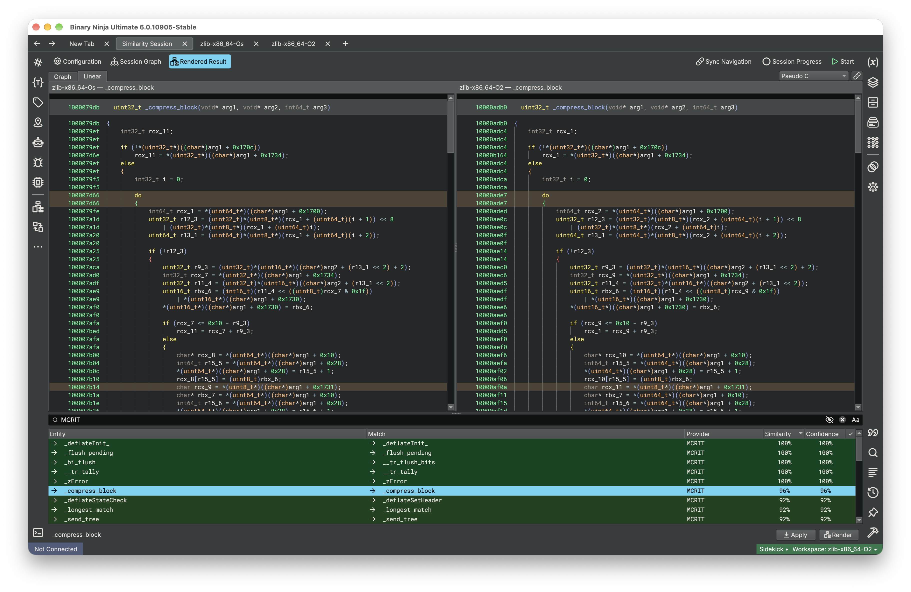
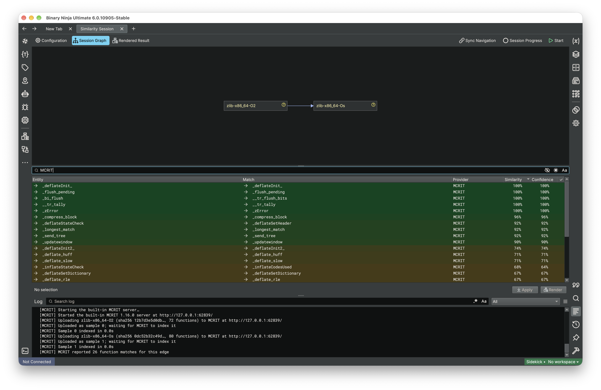
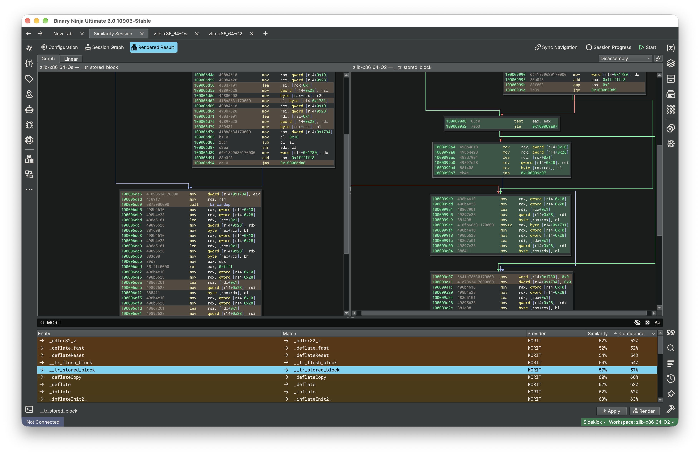

# MCRIT Binary Similarity for Binary Ninja

[](https://github.com/r0ny123/mcrit-binja-similarity/actions/workflows/ci.yml)
[](https://github.com/r0ny123/mcrit-binja-similarity/actions/workflows/binaryninja.yml)
[](https://github.com/r0ny123/mcrit-binja-similarity/releases)
[](LICENSE)

Use [MCRIT](https://github.com/familiary/mcrit) code similarity in Binary Ninja's [Binary Similarity](https://docs.binary.ninja/guide/similarity.html) sessions, next to BinDiff and WARP. Match two binaries, review the pairs side by side, and carry names and types across, all from Binary Ninja's own similarity UI.



## Features

- **MCRIT as a session provider.** Every function in one binary gets its best MCRIT match in the other, scored on Binary Ninja's 0–255 scale.
- **Works out of the box.** By default MCRIT runs inside Binary Ninja. You don't need a server, Docker, MongoDB or an account.
- **Or bring your corpus.** Point it at an MCRIT server or mcritweb, with your API token, to match against shared samples, labels and families.
- **Side-by-side diffs.** Render any match in the Graph or Linear view, as disassembly, IL or pseudo-code. Changed lines are orange, removed red, added green.
- **Apply.** Copy names, types, variables and comments from the matched function, and optionally name unnamed functions after their MCRIT label.
- **Confidence reflects ambiguity.** It drops when another candidate scores close to the best one.
- **x86, x86_64 and aarch64** binaries.

What changed in each release is in [CHANGELOG.md](CHANGELOG.md).

For the MCRIT sidebar that browses a corpus inside IDA, Binary Ninja or Ghidra, see the [MCRIT plugin](https://github.com/familiary/mcrit-plugin). The two install side by side.

## Requirements

Binary Ninja **Ultimate** 6.0, build 10601 or newer. Binary Similarity is an Ultimate feature; on other editions the plugin stays idle.

## Install

**From the extension manager**, once the plugin is listed there: `Plugins > Manage Extensions`, search for **MCRIT Similarity**, and click **Install**. Binary Ninja installs the Python packages it needs (`smda`, `requests` and `mcrit`, about 190 MB with numpy, scipy and lief). Restart Binary Ninja, and it is ready to use.

**From a clone:**

1. Link the repository into Binary Ninja's plugin folder (`Plugins > Open Plugin Folder...` opens it):

   ```bash
   git clone https://github.com/r0ny123/mcrit-binja-similarity
   cd mcrit-binja-similarity
   # macOS
   ln -s "$PWD" ~/Library/Application\ Support/Binary\ Ninja/plugins/mcrit-binja-similarity
   # Linux
   ln -s "$PWD" ~/.binaryninja/plugins/mcrit-binja-similarity
   ```

   ```bat
   :: Windows
   mklink /J "%APPDATA%\Binary Ninja\plugins\mcrit-binja-similarity" "%CD%"
   ```

2. Install the Python packages. Open the command palette (`Cmd+P` / `Ctrl+P`), run `Install python3 module`, and enter one package per line:

   ```text
   smda==5.0.1
   requests
   mcrit==1.16.0
   ```

3. Restart Binary Ninja. The log shows `Registered MCRIT Binary Similarity provider`.

To install the packages from a terminal instead, use the module folder Binary Ninja reads. `python3.13` must match the version Binary Ninja bundles (the folder is named `python3xx`):

```bash
# macOS; on Linux use ~/.binaryninja, on Windows "%APPDATA%\Binary Ninja"
python3.13 -m pip install --target ~/Library/Application\ Support/Binary\ Ninja/python313/site-packages -r requirements.txt
```

If `python.interpreter` in Settings points at your own Python, install into that one.

## Choose a server

Out of the box the plugin uses the built-in server, so there is nothing to set up. To match against your own MCRIT server or mcritweb instead, open Settings (`Cmd+,` / `Ctrl+,`), search for `mcrit_similarity`, and set:

| Server | Server URL | Also set |
|---|---|---|
| Built-in (default) | `builtin` | nothing |
| MCRIT API | for example `http://127.0.0.1:8000/` | nothing |
| mcritweb | `https://<host>/api/` | **Username** and **API token** |

Then run `Plugins > MCRIT Similarity > Test Server Connection`. It reports the server's MCRIT version, or what is wrong with the URL or token, and works with no file open.

## Compare two binaries

1. `File > New Similarity Session`, then **Quick Setup**.
2. Pick the reference binary A and the binary B to find matches in (`Browse files...` if they are not open).
3. Pick a profile. **Review matches first** runs MCRIT next to BinDiff and WARP. **Apply matches automatically** adds a resolver that applies the best match by itself.
4. Let Quick Setup run the session, or press **Start**.

Select B's node in the session graph to list its matches, and type `MCRIT` in the search box to keep only this provider's. **Render** shows the selected pair under **Rendered Result**; **Apply** copies the match into B, except placeholder names such as `sub_140005480`. Both offer to open the binaries if they are not open.

A quick sanity check: functions that have the same name on both sides should match themselves.





> [!TIP]
> For a session with MCRIT alone, remove the other providers under **Configuration**, then save the setup with **Save Current as Profile...** under **Profiles** in the same dialog, for the next Quick Setup. `Add Provider > MCRIT` adds it to a session you set up by hand.

## The built-in server

This is the default. MCRIT starts inside Binary Ninja the first time it is needed, which takes several seconds. It gives the same results as a standalone MCRIT 1.16 server.

- Samples live in memory until Binary Ninja exits, so each run indexes them again. Two binaries of a few thousand functions take seconds.
- It only knows the binaries in your sessions. Matching against a shared corpus, with its labels and families, needs a server.
- It runs in one process, listens only on 127.0.0.1, and accepts only a token generated for each run.
- Stopping a session takes effect once the sample being indexed or matched is done.

## Running an MCRIT server

For a corpus that persists and is shared, the quickest server is [docker-mcrit](https://github.com/familiary/docker-mcrit):

```bash
git clone https://github.com/familiary/docker-mcrit && cd docker-mcrit
chown -R 10001:10001 storage/mcritweb
docker compose up -d
```

The first start builds both images and takes a while. The first account registered in the web interface becomes the administrator. The MCRIT API is then on `http://127.0.0.1:8000/` and [mcritweb](https://github.com/familiary/mcritweb) on `http://127.0.0.1:5000/api/`, both loopback only. An existing server works the same way with its URL.

> [!NOTE]
> Through mcritweb, uploading samples needs a contributor or admin token, and mcritweb drops the matching parameters (MinHash threshold, PicHash size, LSH bands). Point the plugin at the direct API for those settings to apply.

## Settings

Under Settings > **MCRIT Binary Similarity**:

| Setting | Meaning |
|---|---|
| Server URL | `builtin` (the default), an MCRIT API URL, or mcritweb's `/api/` URL |
| Username | `username` header for mcritweb |
| API token | Moved into the system keychain on first use, after which the field reads empty. Enter a new token to replace it |
| Request timeout | Seconds per HTTP request |

Each session also has options under **Configuration**: MinHash threshold, PicHash size, LSH bands, maximum candidates, library matches, uploads (with an optional family and version), and two opt-ins:

- **Apply corpus labels**: when neither function has a real name, Apply names the function after the target's MCRIT label.
- **Query per node**: with several incoming edges, query the corpus once and split the result per edge, instead of one MatcherVs per edge. Slower on large corpora; direct API only.

To delete a stored token, run this in the Python console:

```python
SecretsProvider["SystemSecretsProvider"].delete_data("mcrit_similarity.api_token")
```

## How it works

Each binary is exported to an SMDA report from Binary Ninja's analysis and looked up on the server by the report's SHA256. For PE files that is the hash of the mapped image, which can differ from the file's own hash, so a sample already on the server under its file hash is uploaded again. MCRIT's MatcherVs then matches the pair, and only the matched functions are fetched.

**Uploads.** An unknown sample is uploaded only when *persist samples* is on. It is on by default for local servers and always on for the built-in one. For remote servers it is off, because an upload sends the binary's disassembly to that server; turn it on per session when you mean to.

**Scores.** MCRIT's 0–100 score maps to Binary Ninja's 0–255. A tie with another candidate halves the confidence, a lead of 10 points or more keeps it, and a PicHash match gets full confidence only when no other function shares that PicHash. A result is named after the target's MCRIT label when the target has no symbol.

**Rendering.** The two functions are aligned by PicBlock hash, and leftover blocks are paired by instruction similarity. Only the instructions that differ are marked, and functions that are identical stay unpainted. This works in the Graph and Linear views for every view type the selector offers: Disassembly, Low/Medium/High Level IL, and Pseudo C, Objective-C and Rust.

**Cache.** SMDA reports are cached under `<Binary Ninja user folder>/mcrit_similarity/smda_reports` (512 MiB or 1000 files, least recently used removed first). After a restart, reports for binaries up to 64 MiB reload in the background once analysis finishes. Delete the folder to clear it.

## Security

- The API token is kept in the system keychain and never logged. Where no keychain is available, the log says so and the token stays in Binary Ninja's settings.
- A token is only sent over HTTPS, or HTTP to a loopback address. Redirects and credentials in the URL are refused.
- Certificates are verified. For a private CA, set `REQUESTS_CA_BUNDLE` before starting Binary Ninja.
- Uploads to remote servers are opt-in.

To report a vulnerability, see [SECURITY.md](SECURITY.md).

## Headless

```python
from binaryninja import SimilarityProviderType, SimilaritySession

provider_type = SimilarityProviderType["MCRIT"]
provider = provider_type.create(provider_type.get_default_settings())
session = SimilaritySession()
session.add_provider(provider)
# add nodes, session.graph.add_edge(a, b), then session.run()
```

`session.run()` returns at once; wait on `completion.is_finished` as in the [official example](https://docs.binary.ninja/guide/similarity.html#python-and-headless-usage). [`examples/headless_mcrit.py`](examples/headless_mcrit.py) is a complete script that uses the server configured in Settings:

```bash
PYTHONPATH="/Applications/Binary Ninja.app/Contents/Resources/python" \
    .venv/bin/python examples/headless_mcrit.py reference-binary match-binary
```

## Troubleshooting

Binary Ninja's [similarity troubleshooting guide](https://docs.binary.ninja/guide/similarity.html#troubleshooting) covers the session side. For this plugin:

| Symptom | Fix |
|---|---|
| Log says `MCRIT Similarity requires Binary Ninja Ultimate 6.0+` | Binary Similarity needs Ultimate. |
| No results, or requests fail | Check the URL: mcritweb needs the trailing `/api/`, the direct API does not. Raise *Request timeout* for slow uploads. |
| `403` | The token is missing or wrong (Test Server Connection says which), or it cannot upload. Uploads need contributor or admin rights; if both samples are already on the server, turning *persist samples* off also works. |
| `MCRIT applied different matching parameters than requested` | The server, usually mcritweb, ignored or capped your MinHash threshold, PicHash size or LSH bands. Use the direct API to keep them. |
| No matches between different architectures | Expected: MCRIT matches within one architecture. |
| Render says `no SMDA report is cached` after a restart | Run the session again; reports reload once analysis finishes. |
| `cannot import the mcrit package: the module named mcrit at … is something else` | A plugin folder named `mcrit` hides the package. Rename it, for example to `mcrit-plugin`. |
| A session option changed under Configuration has no effect | Binary Ninja 6.0 only passes on options changed in the same dialog that added MCRIT. Select MCRIT, **Remove Provider**, **Add Provider**, change the options, then close the dialog. |
| Two sets of MCRIT settings | The **MCRIT** group belongs to the MCRIT plugin; this plugin's is **MCRIT Binary Similarity**. |

For anything else, [open an issue](https://github.com/r0ny123/mcrit-binja-similarity/issues/new/choose).

## Development

```bash
python -m venv .venv && source .venv/bin/activate
python -m pip install -e ".[dev]"
ruff format . && ruff check . && ty check
python -m pytest tests
```

The default suite runs against a stub of the Binary Ninja API and needs no license. To run it against a real headless Binary Ninja, which also analyses the zlib builds in `tests/fixtures/`:

```bash
python "/Applications/Binary Ninja.app/Contents/Resources/scripts/install_api.py"  # with the venv active
MCRIT_TEST_REAL_BINARYNINJA=1 python -m pytest tests
```

The end-to-end tests also start a throwaway MCRIT server (in memory, no MongoDB) on a loopback port and run real sessions:

```bash
MCRIT_TEST_REAL_BINARYNINJA=1 MCRIT_TEST_E2E=1 python -m pytest tests -m e2e
```

- `MCRIT_E2E_SERVER_URL` uses a server you run instead. The tests reset it with `POST /respawn`, so never point it at data you want to keep.
- `MCRIT_E2E_STORAGE=mongodb` runs against MCRIT's deployed shape, MongoDB plus a worker (`MCRIT_E2E_MONGO_HOST`, `MCRIT_E2E_MONGO_PORT`, `MCRIT_E2E_MONGO_DB`).

Maintained by [r0ny123](https://github.com/r0ny123). Contributions are welcome: see [CONTRIBUTING.md](CONTRIBUTING.md) and the [Code of Conduct](CODE_OF_CONDUCT.md).

## License

[GPL-3.0-only](LICENSE), matching the MCRIT projects it works with. The plugin talks to MCRIT over REST, or runs the `mcrit` package it installs as a dependency, and contains none of its code.

| Component | License | Use |
|---|---|---|
| [SMDA](https://github.com/danielplohmann/smda) | BSD-2-Clause | dependency |
| [Requests](https://github.com/psf/requests) | Apache-2.0 | dependency |
| [MCRIT](https://github.com/familiary/mcrit) | GPL-3.0 | dependency, built-in server |
| [zlib](https://www.zlib.net/) 1.3.1 | [zlib License](tests/fixtures/zlib_License.txt) | test binaries in `tests/fixtures/` |

Binary Ninja is proprietary software by Vector 35 and is not part of this repository.
